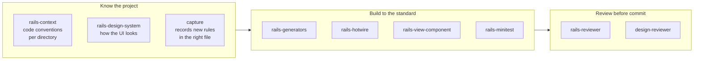

# Agent Skills

[](https://github.com/mooktakim/skills/actions/workflows/test.yml)
[](LICENSE)

A hand-authored collection of skills, agents, and hooks for coding agents, packaged as a [Claude Code](https://code.claude.com) plugin marketplace. Each skill is its own plugin, so you install only the ones you want.

The plugins share one aim: make the agent follow a project's real conventions, every session, without being told twice. They write those conventions into checked-in files, load them at the moment they matter, and back the most important rules with checks that run in hooks and CI.

The conventions go to `AGENTS.md`, so any coding agent can read them. The plugins themselves run in Claude Code, where each one is used daily on real projects and covered by this repository's test suite.

## Install

Add the marketplace once:

```
/plugin marketplace add mooktakim/skills
```

Then install the plugins you want:

```
/plugin install rails-context@mooktakim
```

Run `/plugin` to browse and manage everything interactively, and `/plugin marketplace update mooktakim` to pick up new versions. Start a new session after installing, so the plugin's hooks and commands load.

## Plugins

### Rails

| Plugin | What it does |
|--------|--------------|
| [`rails-context`](rails-context/) | Per-directory `AGENTS.md` context files across a Rails app, so Claude inherits each directory's conventions, with a drift audit and hooks that keep them current. |
| [`rails-design-system`](rails-design-system/) | Codifies the app's UI into a design system on Tailwind CSS v4 (role tokens, component specs, page patterns), enforced at edit time and in CI, with a design-reviewer agent. |
| [`rails-hotwire`](rails-hotwire/) | One standard for Turbo Drive, Frames, Streams, broadcasts, morphing, and Stimulus, with an app audit and a `hotwire-builder` agent. |
| [`rails-view-component`](rails-view-component/) | One standard for ViewComponent libraries: writing, composing, testing, and wiring components into Turbo and Stimulus, with a library audit and a `component-builder` agent. |
| [`rails-minitest`](rails-minitest/) | One standard for Minitest suites: every kind of test, fixtures, helpers, speed, coverage, and flaky tests, with a suite audit and a `minitest-runner` agent. |
| [`rails-generators`](rails-generators/) | Makes Claude use Rails generators and commands instead of hand-writing their files, with a guard against hand-written migrations and edits to generated files. |
| [`rails-specialists`](rails-specialists/) | Eight specialist agents for models, jobs, debugging, review, security, performance, deployment, and upgrades, each following the project's own stack. |

### Any project

| Plugin | What it does |
|--------|--------------|
| [`project-memory`](project-memory/) | Long-term project memory in git: typed notes with citations, a generated index, an inbox for unverified knowledge, and an append-only work log, checked by a fast Rust command. |
| [`capture`](capture/) | Records a rule you state, or a correction you make, in the one checked-in file where it belongs, so you never have to say it again. |
| [`toolsmith`](toolsmith/) | Finds shell patterns Claude repeats in your Claude Code history and replaces them with small, tested, single-purpose Rust commands. |

Each plugin's README covers what it ships, how to use it, and what it needs.

## How the Rails plugins fit together



The Rails plugins work alone, and each one knows about the others:

- **`rails-context`** documents how the code is written, directory by directory. **`rails-design-system`** documents how the UI looks. **`capture`** routes any new rule you state into the right one of those files.
- **`rails-hotwire`**, **`rails-view-component`**, and **`rails-minitest`** set the standard for how interactive UI, components, and tests are built. None of them sets visual rules: those come from the design system.
- **`rails-generators`** keeps Claude on the framework's own commands for every file Rails can generate.
- **`rails-specialists`** reviews, debugs, and audits the result. Its `rails-reviewer` runs in parallel with the design system's `design-reviewer` when both apply.

## Requirements

- [Claude Code](https://code.claude.com) CLI or desktop app, to install and run the plugins.
- Ruby for the hooks and audit scripts. Any Ruby from 2.6 works, including the macOS system Ruby.
- [Rust](https://rustup.rs) (`cargo`) for `toolsmith` and `project-memory`, which build their commands on first use.

## Development

Every plugin is a directory at the repository root with a `.claude-plugin/plugin.json` manifest and a `SKILL.md`, an `agents/` directory, or both. [`AGENTS.md`](AGENTS.md) holds the full authoring conventions, and [`docs/`](docs/) holds this repository's own project memory (design decisions and a log of past work), not user documentation.

```sh
bin/test                          # Minitest suite: runs the real scripts and hooks in throwaway git repos
TEST_RUBY=/usr/bin/ruby bin/test  # the same suite on the macOS system Ruby
claude plugin validate .          # validate the marketplace manifest
```

CI runs the suite on Linux with current Rubies and Ruby 2.6, and on macOS with the system Ruby and bash 3.2.

## License

[MIT](LICENSE)
