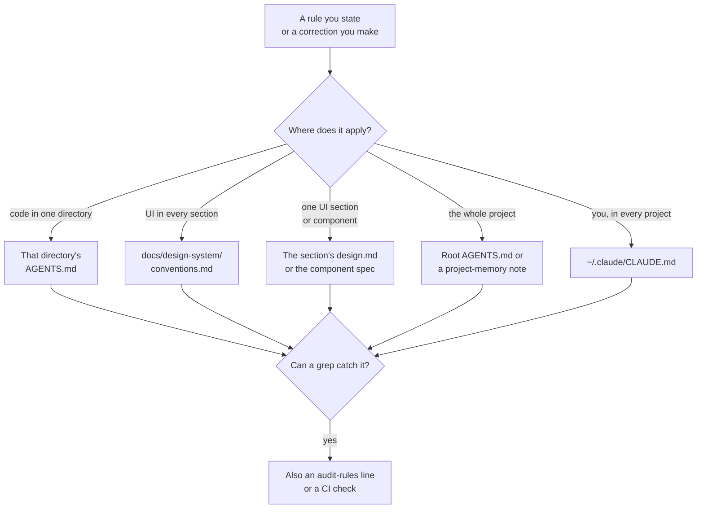

# capture

Records a rule you state, or a correction you make, into the one checked-in context file where it belongs - so you never have to say it again.

A correction you have to repeat is a gap in the project's context. Auto memory doesn't close it: it lives on one machine and isn't in git. This skill writes the rule where every future session, teammate, and agent reads it.

## Install

```
/plugin marketplace add mooktakim/skills
/plugin install capture@mooktakim
```

## How it works

1. **Claude offers.** After you correct how it works ("no, don't use trailing slashes", "from now on run the tests first"), Claude handles the request, then offers in one line to record the rule - the rule as it would write it, and the file it would go to. A small `UserPromptSubmit` hook reminds it when a prompt reads like a correction; Claude still judges whether it is a lasting rule. You can also ask directly: "remember this", or `/capture:capture`.
2. **One fact, one place.** The rule goes to the most specific file it applies to: a directory's `AGENTS.md` for code conventions there (its `CLAUDE.md` imports it), `docs/design-system/conventions.md` for UI rules every section shares, a section's `design.md` or a component spec for narrower UI rules, the root `AGENTS.md` for project-wide rules, or your global `~/.claude/CLAUDE.md` for your own rules everywhere (with a second confirmation).
3. **Already recorded?** If the rule is already written where it belongs, Claude says so - the problem is that it wasn't followed - and proposes clearer wording, a better location, or a check instead of a duplicate.
4. **You approve the exact text.** Nothing is written until you approve the line and the target.
5. **Enforced when possible.** If a grep can catch the rule, Claude proposes a check too: an `audit-rules` line in apps with a design system (enforced by `bin/audit_design` and its hooks), or a linter/CI step elsewhere.



One-off taste ("I don't like this layout") and task instructions are not recorded. The same taste correction a second time is, as a design rule.

## Works in any project

In Rails apps set up with `rails-context` and `rails-design-system`, it routes into their files and follows their formats and size limits. In projects set up with `project-memory`, project-wide conventions, traps and procedures go to curated notes under `docs/` (your approval counts as the promotion the protocol asks for), and the root `AGENTS.md` keeps only the few hard rules every task needs.

---

Part of [mooktakim/skills](../README.md), a plugin marketplace for Claude Code. MIT licensed.
