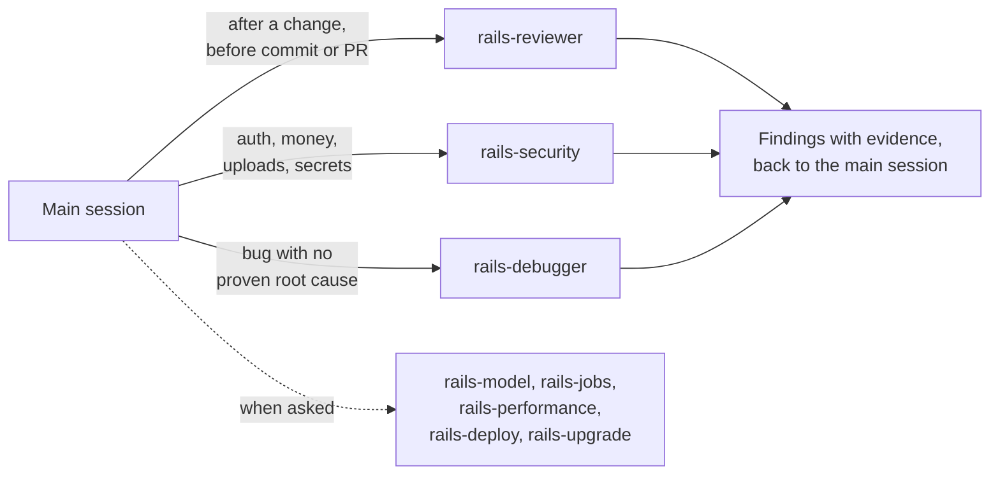

# rails-specialists

A team of eight Rails specialist agents for Claude Code. Each agent owns one slice of Rails work - the data layer, background jobs, debugging, review, security, performance, deployment, upgrades - and carries the focused expertise and working discipline for that slice, so the main session can delegate instead of context-switching.

The agents are stack-agnostic: every one starts by reading the Gemfile and config to learn what the project actually uses (Minitest or RSpec, Solid Queue or Sidekiq, Kamal or Heroku, ViewComponent or partials) and follows the project's own conventions rather than imposing defaults.

## Install

```
/plugin marketplace add mooktakim/skills
/plugin install rails-specialists@mooktakim
```

## What it ships

| Agent | Specialty | Writes code? |
|---|---|---|
| `rails-model` | ActiveRecord models, associations, validations, safe reversible migrations, schema design | yes |
| `rails-jobs` | Background jobs, mailers, recurring work, Action Cable | yes |
| `rails-debugger` | Reproduces bugs, digs logs and console state, returns a proven root cause | read-only |
| `rails-reviewer` | Code review of a diff/branch: correctness, conventions, migration safety, layering | read-only |
| `rails-security` | Brakeman + dependency audit + manual authz/injection/mass-assignment review | read-only |
| `rails-performance` | N+1s, indexes, query plans, memory, caching - with measurements as evidence | read-only |
| `rails-deploy` | Deploy config, Dockerfiles, process topology, health checks, CI | yes |
| `rails-upgrade` | Rails/Ruby/gem upgrades in small green steps, defaults-flag by defaults-flag | yes |

### Moved to other plugins

Hotwire front-end work moved to the separate [`rails-hotwire`](../rails-hotwire/) plugin in version 0.5.0: its `rails-hotwire:hotwire-builder` agent replaces the `rails-hotwire` agent that used to ship here, with the rails-hotwire skill preloaded. ViewComponent work goes to [`rails-view-component`](../rails-view-component/)'s `component-builder`.

Test work - running suites, writing tests, diagnosing failures - moved to the separate [`rails-minitest`](../rails-minitest/) plugin in version 0.4.0. Its `rails-minitest:minitest-runner` agent replaces the `rails-tester` that used to ship here, and the plugin adds the standard it writes tests to.

## Philosophy

**Specialists, no manager.** There is deliberately no architect/orchestrator agent. The main session stays in charge of the plan, the conversation, and every approval; specialists are dispatched with pre-resolved inputs and report back. An agent never asks the user anything.

**Two reasons to delegate.** An agent earns its place either by isolating noisy work (test runs, log digs, scanner output stay out of the main context) or by carrying deep domain discipline (migration safety, job idempotency, query plans) so the main session doesn't need re-prompting.

**Detect, don't assume.** Every agent reads the Gemfile, config, and neighbouring code before acting, and matches the project's idiom - even where it differs from common defaults.

**Advisors are read-only.** The debugger, reviewer, security, and performance agents have file editing disabled. They return diagnoses and findings with evidence; fixing is a separate, deliberate step by the caller or a writing specialist.

**Delegation at fixed moments.** Agent descriptions alone rarely win against the built-in general-purpose agent, so the plugin ships a `SessionStart` hook that, in Rails projects only, tells the main session when to delegate without being asked: `rails-reviewer` after implementing a change and before committing or opening a PR (trivial changes skipped), `rails-security` when a change touches auth, money, uploads, or secrets and before a production deploy, and `rails-debugger` when a bug's root cause is not yet proven. Each review costs tokens (roughly 100-200k for a feature-sized diff); that is the deliberate trade for catching bugs before they merge. When several reviews apply to one change (including `rails-design-system:design-reviewer`), the hook asks for them in a single message so they run in parallel, and for each prompt to name the changed files and the intent, so the agents skip rediscovering the scope. The writing specialists stay on-demand.



**Reports, not transcripts.** Each agent ends with a structured report - what changed or what was found, the evidence, and the follow-ups for other specialists - never raw tool output.

## Usage

Mostly you don't invoke them - you just work. The agents' descriptions tell Claude when to delegate: ask for a code review before committing and `rails-reviewer` fires; report a bug and `rails-debugger` reproduces it.

To invoke one explicitly, @-mention it:

```
@rails-specialists:rails-security audit the changes on this branch
@rails-specialists:rails-performance why is the dashboard slow?
@rails-specialists:rails-upgrade take us from Rails 7.2 to 8.0
```

The read-only agents (debugger, reviewer, security, performance) hand back findings; apply fixes yourself or dispatch the matching specialist with the findings as input.

## Requirements

- A Rails application.
- Optional: Brakeman and bundler-audit, which `rails-security` runs when the app has them.

---

Part of [mooktakim/skills](../README.md), a plugin marketplace for Claude Code. MIT licensed.
