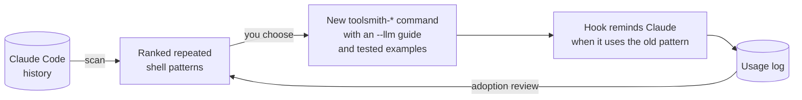

# toolsmith

Claude repeats the same shell patterns hundreds of times: a Python heredoc that opens a file, asserts some text is there, replaces it and writes it back; a `date`/`mkdir`/heredoc chain to add a history log entry; a loop of CI checks. This plugin finds those patterns in your Claude Code history and replaces them with small Rust commands that do one job each, have a guide written for an LLM, and are tested against that guide. It then measures whether Claude uses them and whether they help.

## Install

```
/plugin marketplace add mooktakim/skills
/plugin install toolsmith@mooktakim
```

Start a new session after installing or updating, so the new `bin/` is on PATH.

## Commands

| Command | Job |
|---------|-----|
| `toolsmith-text-replace` | Replace exact, literal text in existing files as one all-or-nothing change. |
| `toolsmith-history-add` | Add one new entry file to the project's `docs/log` history. |
| `toolsmith-file-lines` | Print numbered line ranges from several files in one call. |
| `toolsmith-check-run` | Run a check command, printing only its outcome with any failures. |
| `toolsmith-files-write` | Create several new files from one stdin bundle, never overwriting by accident. |
| `toolsmith-json-set` | Set one value in a JSON file, keeping its existing layout. |
| `toolsmith-ci-wait` | Wait for the CI runs of one commit to finish, printing only what failed. |
| `toolsmith-pr-land` | Merge a pull request, then return the local clone to its updated base branch. |
| `toolsmith-conflict-resolve` | Resolve git merge-conflict blocks in files as one all-or-nothing change. |

Run any command with `--help` for a summary, or `--llm` for the full guide: when to use it, input format, exit codes and tested examples.

## How it works

- **On PATH, no install step.** Claude Code puts a plugin's `bin/` on the Bash tool's PATH. Each file there is a two-line shim that builds its Rust binary (`cargo build --release`, into `target/`) the first time it runs and again whenever the source is newer, then runs it. Plugin `bin/` entries come after your own PATH entries, so a tool can never shadow one of your commands.
- **Nothing shadows a tool unnoticed.** Every name starts with `toolsmith-`. At session start a hook checks PATH, and a tool whose name another command already has is left out of Claude's list, with a warning.
- **Claude knows the commands.** The `SessionStart` hook lists each command with its one-line job. The `PreToolUse` hook watches Bash commands: when one matches the pattern a tool replaces (from `families.json`), it reminds Claude of the tool, once per session and tool, and not in subagents (they never get the command list). The hook never blocks unless you switch a tool to `"mode": "block"`, and if it cannot run, the command runs as normal.
- **One contract for every tool.** One job, a `toolsmith-<object>-<verb>` name, a complete `--llm` guide, and examples that the test suite runs against the real binary, checking every file before and after. See [references/contract.md](references/contract.md).

## Finding new tools and measuring them

The `toolsmith` skill has three workflows. Ask in plain words ("scan my Claude history for tool ideas", "build that tool", "are the toolsmith tools helping?") or run `/toolsmith:toolsmith`.



1. **Scan.** `scripts/analyse scan` reads `~/.claude/projects` (2.5 GB in about 8 seconds) and ranks the repeated patterns. `scripts/analyse examples` shows real commands for a pattern. Claude proposes a shortlist; you choose.
2. **Build.** Claude writes the tool's manifest first and shows you the design, then the code, the tests and a real trial run.
3. **Review adoption.** `scripts/analyse adoption` shows, per tool and week, tool calls against calls that still use the old pattern, plus failures, guide reads, and how often a reminder led to a run.

Two records feed the numbers:

- **The usage log** at `~/.local/state/toolsmith/usage.jsonl` (or `$XDG_STATE_HOME/toolsmith/`, or `$TOOLSMITH_LOG`): one line per run and per reminder, with the time, tool, exit code and duration. It never holds arguments or input. Set `TOOLSMITH_LOG=` (empty) to turn it off.
- **Weekly snapshots** in `metrics/weekly.json`: counts only, committed with each scan. Claude Code deletes transcripts after `cleanupPeriodDays` (30 by default), and the snapshot keeps the trend after that.

The session-start note says when a scan is more than a week old.

## Requirements

- Rust (`cargo`) to build the tools on first use. Without it, a command explains how to install Rust.
- The GitHub CLI (`gh`), signed in, for `toolsmith-ci-wait` and `toolsmith-pr-land`.
- Ruby (the macOS system Ruby is enough) for the hooks and the analysis.
- Claude Code CLI or desktop. claude.ai and Cowork do not install plugins that ship a `bin/` directory.

---

Part of [mooktakim/skills](../README.md), a plugin marketplace for Claude Code. MIT licensed.
